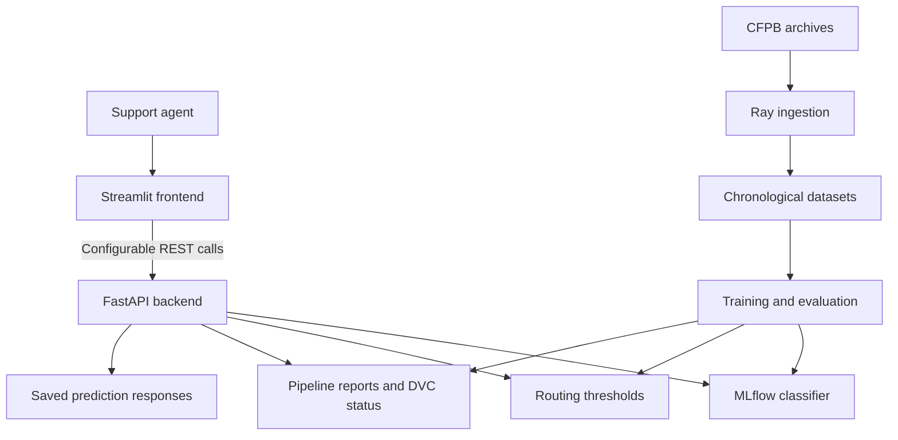

# Architecture

## Block explanations

- Frontend: complaint entry, CSV upload, results, help and pipeline screen.
- Backend: input validation, model loading, inference and routing.
- Model: TF-IDF and calibrated LinearSVC, selected by validation macro-F1.
- Policy: thresholds for predicted categories; uncertain inputs require review.
- Ray: reads ZIPs, filters complaints and creates chronological datasets.
- DVC: tracks datasets and orchestrates processing and validation stages.
- MLflow: records experiments, packaged models and evaluation results.
- Reports: saved metrics, test outcomes and prediction responses without text.

Docker packaging, monitoring and drift/retraining are subsequent stages.
