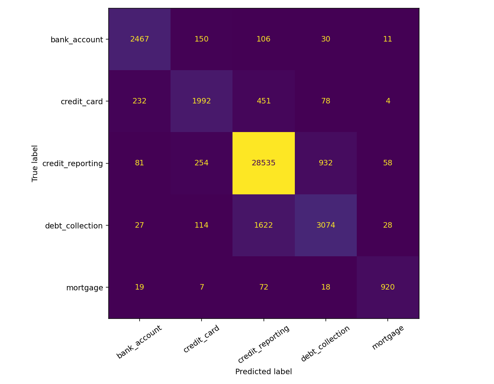

# Data, model development and evaluation

## Dataset provenance

Source: public CFPB Consumer Complaint Database. The initial exports were obtained
through the official filtered CSV download interface, preserving three ZIPs:

| Archive | Inclusive dates | Input rows |
|---|---|---:|
| `cfpb_2024_04_07.zip` | 2024-04-01 to 2024-07-31 | 839,903 |
| `cfpb_2024_08_10.zip` | 2024-08-01 to 2024-10-31 | 824,514 |
| `cfpb_2024_11_12.zip` | 2024-11-01 to 2024-12-31 | 591,058 |

The source link and SHA-256 checksums are versioned in
[raw_sources.json](../config/raw_sources.json). The ZIPs are DVC-managed.
Each archive contains one UTF-8 CSV with the CFPB export columns, including
Complaint ID, Date received, Product and Consumer complaint narrative.
Downloads cover all products; ingestion filters the five selected products
and removes records without narratives.

The [official source](https://www.consumerfinance.gov/data-research/consumer-complaints/)
provides exports/API access and generally updates daily. Re-exporting a historical
date range may not reproduce the saved ZIP bytes/rows. Use the preserved DVC
snapshot for exact reproduction; no immutable original download URL is claimed.
Creating a new source snapshot requires new checksums and explicit experiment
provenance, not relabelling a different download as the pinned data.

## Data quality and exploratory findings

Ray runs two one-CPU archive tasks concurrently, streams CSV records and writes
temporary candidates. The driver deduplicates in chronological split order,
using complaint IDs and SHA-256 of case-insensitive whitespace-normalised text.
Final outputs are installed after class/date checks. Temporary candidate files
are cleaned by the temporary-directory context.

Across 2,255,475 input records, ingestion recorded 46,275 exclusions for other
products, 1,574,895 missing narratives, and 634,305 candidate records. Deduplication
removed 303,530 candidates, leaving 330,775 rows across four datasets.
These are filtering/deduplication dispositions, not a claim that the CFPB source
is otherwise error-free.

| Split | Dates | Rows | bank | card | credit reporting | debt | mortgage |
|---|---|---:|---:|---:|---:|---:|---:|
| Train | Apr–Jul | 138,334 | 9,630 | 10,524 | 99,703 | 14,576 | 3,901 |
| Validation | Aug–Sep | 74,277 | 4,940 | 5,261 | 53,795 | 8,161 | 2,120 |
| Original test | October | 38,806 | 2,615 | 2,658 | 27,833 | 4,688 | 1,012 |
| Future simulation | Nov–Dec | 79,358 | 5,632 | 5,233 | 57,390 | 9,080 | 2,023 |

Recorded ingestion duration: **23.411 seconds**, throughput
**96,341.28 input rows/second**, including Ray startup, reading, filtering,
deduplication and output checks. This is one development-VM measurement,
not a scaling benchmark.

Credit reporting dominates the data, supporting class-balanced estimators and
macro-F1 selection. Publicly shared narratives and publication/consent processes
introduce selection bias; the dataset is not representative of every customer
experience. De-identification/repeated templates help explain heavy duplication.
The corpus is restricted to one country, five products and a historical period.
No demographic fairness study or semantic near-duplicate analysis was performed.

This constitutes basic distribution/quality EDA. No separate exhaustive
outlier, subgroup fairness, feature-importance or feature-ablation report is
supplied.

## Feature and model fitting

Only `text` is a predictive feature. IDs/dates support auditing/splits; the CFPB
product becomes the target. Model inference collapses internal whitespace,
matching ingestion. TF-IDF uses up to 40,000 features, unigram/bigram tokens,
`min_df=3`, sublinear term frequency and float32 sparse values.
The vectorizer is fitted on training data.

Both estimators use balanced classes, C=1 and random seed 42:

- Logistic Regression: lbfgs, max_iter 1000.
- LinearSVC: dual auto, max_iter 5000; wrapped in sigmoid
  CalibratedClassifierCV with three training-data folds, ensemble false,
  n_jobs 1.

Training limits numerical-library threads to two and treats convergence warnings
as errors. This is a two-model comparison with fixed hyperparameters, not a
grid search. Calibration/preprocessing use the training split; outer
validation/October/December labels are not used to fit the original model.

| Model | Validation macro-F1 | Accuracy | Log loss | Fit+validation seconds |
|---|---:|---:|---:|---:|
| Logistic Regression | 0.816939 | 0.875278 | 0.382086 | 95.890 |
| Calibrated LinearSVC | 0.829705 | 0.898582 | 0.308006 | 149.262 |

The majority-class baseline has macro-F1 0.168015 and accuracy 0.724248.
Selection uses highest validation macro-F1, then accuracy, then model name
for deterministic ties. Original selected training run:
`376d762990d44d59af5080825e9be19a`, source commit `40ec18821248d1f88140f751a09f8e97d13e0f91`.

## Routing operating point

Each predicted category receives a threshold selected from 0.50–0.99 in 0.01
steps. Among candidates with at least 100 automatically routed validation
examples and empirical accuracy ≥0.95, choose maximum coverage, then the
lower threshold on ties. If none qualifies, disable automatic routing for
that category. This uses predicted categories available at inference.

| Category | Original threshold | Candidate threshold |
|---|---:|---:|
| Bank account | 0.74 | 0.73 |
| Credit card | 0.86 | 0.89 |
| Credit reporting | 0.67 | 0.60 |
| Debt collection | 0.98 | 0.94 |
| Mortgage | 0.69 | 0.60 |

The original October evaluation recorded macro-F1 0.826418, overall accuracy
0.895222, automatic coverage 0.804128 and automatic accuracy 0.946611.
Validation precision targets are empirical operating-point targets, not
guarantees on held-out periods.

## Historical lifecycle and leakage controls

| Role | Period | Rows |
|---|---|---:|
| Monitoring and added candidate training | Nov 1–15 | 19,578 |
| Candidate threshold selection | Nov 16–22 | 9,585 |
| Candidate acceptance | Nov 23–30 | 8,913 |
| Reserved final evaluation | December | 41,282 |

Monitoring samples 5,000 original-training reference rows and 5,000 November
rows for the distribution proxies, with deterministic seed 42. Labelled
performance uses all 19,578 monitoring rows. Base-2 Jensen–Shannon divergence
compares text-length bins and predicted-product counts.

Recorded length JSD: 0.003649; product JSD: 0.001210; labelled macro-F1:
0.832779. Neither JSD exceeded 0.10 and F1 did not fall below 0.80, so
`retraining_required=false` and the normal controller returned `no_trigger`.
An explicit demonstration then trained a candidate; no automatic event is claimed.

The candidate clones the original model pipeline and fits 157,912 rows:
138,334 original training rows plus 19,578 new rows. Its thresholds use the
9,585 separate November tuning records. Both models are evaluated on the
same 8,913 acceptance records.

| Acceptance measure | Original | Candidate |
|---|---:|---:|
| Macro-F1 | 0.830577 | 0.837020 |
| Accuracy | 0.903175 | 0.906429 |
| Automatic count | 7,346 | 7,504 |
| Automatic coverage | 0.824189 | 0.841916 |
| Automatic accuracy | 0.950585 | 0.948694 |

The macro-F1 gain is 0.006443. All six fixed acceptance checks passed, including
the allowed automatic-accuracy decrease and per-class recall guardrails.
This is the valid same-period head-to-head comparison; October-to-December
differences alone do not establish model improvement.

The future CSV contains both months, but modules filter the intended periods
before fitting/scoring. The acceptance and final scripts check chronology,
ID disjointness and normalised-text disjointness. December predictions and
labels do not change model choice or thresholds.

## Final selected-model result

Selected training run: `caa8bd53da5f4fb1871725b08a80ec70`.
Source commit: `1a1af3f7daf3e2f38eaae5a2f590576f30020497`.
Final evaluation run: `8cef03df53f54c78b2a23bddcc0ad109`.

| Measure | December value |
|---|---:|
| Macro-F1 | 0.831386 |
| Accuracy | 0.895984 |
| Automatic count | 34,288 / 41,282 |
| Automatic coverage | 0.830580 |
| Automatic accuracy | 0.942545 |
| Human-review fraction | 0.169420 |

Per-class recall: bank accounts 0.892547; credit cards 0.722524;
credit reporting 0.955626; debt collection 0.631860; mortgages 0.888031.
The weaker debt/card results and majority imbalance remain important limitations.

Metrics were independently recomputed from the three saved final/acceptance
prediction CSVs during this documentation audit and matched their summaries.
The raw data/model binaries were not in the uploaded ZIP, so this audit did
not independently rerun model fitting or verify every raw example.

Further limits: recognised vocabulary is not complete OOD detection; historical
labels are assumed available after arrival; no confidence intervals, fairness
audit, load benchmark or concept-drift guarantee is provided. Review flags and
estimated confidence support human decisions rather than replacing judgement.
